# Mighty FX Micropython Drawing Examples <!-- omit in toc -->

This folder contains a collection of *Drawing* examples, the showcase examples redrawn as drawings. A drawing plays on a screen from a `drawing` entry in `effects.txt` or from the picker's Screens tab, alongside the lights and the other screen. Each comes with a picture of it, which the picker shows on its card.

- [Transport Signs](#transport-signs)
  - [Roadworks Sign](#roadworks-sign)
  - [Split Flap Departures](#split-flap-departures)
  - [Departures List](#departures-list)
  - [Bus Departures](#bus-departures)
- [Retro Displays](#retro-displays)
  - [Flip Dot Sign](#flip-dot-sign)
  - [Split Flap Clock](#split-flap-clock)
  - [CRT Terminal](#crt-terminal)
  - [Acrylic Lixie](#acrylic-lixie)
  - [Nixie Tube](#nixie-tube)
  - [Segment Clock](#segment-clock)
  - [Segment Sign](#segment-sign)
  - [Odometer](#odometer)
  - [Lamp Matrix](#lamp-matrix)
  - [Oscilloscope](#oscilloscope)
- [Billboards and Panels](#billboards-and-panels)
  - [Trivision Billboard](#trivision-billboard)
  - [Street Billboard](#street-billboard)
- [Animated Scenes](#animated-scenes)
  - [Laser Show](#laser-show)
  - [Fireplace](#fireplace)
  - [Portal](#portal)
  - [Pool](#pool)
  - [Neon Corridor](#neon-corridor)
  - [Creature Eyes](#creature-eyes)

## Transport Signs

Departure boards and road signs.

### Roadworks Sign
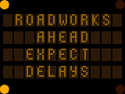

[roadworks_sign.py](roadworks_sign.py)

Draw a roadside roadworks sign with its message in amber lamps.

 

### Split Flap Departures
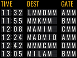

[split_flap_departures.py](split_flap_departures.py)

Draw a split-flap departures board with each letter flipping into place.

 

### Departures List
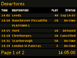

[departures_list.py](departures_list.py)

Draw a railway departures list.

 

### Bus Departures
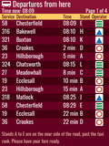

[bus_departures.py](bus_departures.py)

Draw a bus departure board as shown on a TV screen at a bus station.

 

## Retro Displays

Mechanical, glowing and segment displays.

### Flip Dot Sign
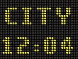

[flip_dot_sign.py](flip_dot_sign.py)

Draw a flip-dot sign that spells its message in a sweep, each column of dots starting to flip just after the one before.

 

### Split Flap Clock
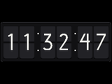

[split_flap_clock.py](split_flap_clock.py)

Draw a split-flap clock with each digit flipping through to the next.

 

### CRT Terminal
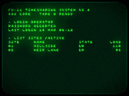

[crt_terminal.py](crt_terminal.py)

Draw an old green-screen computer terminal. An operator types a command a character at a time and the machine answers a line at a time, on a tube that glows.

 

### Acrylic Lixie
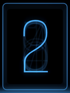

[acrylic_lixie.py](acrylic_lixie.py)

Draw a lixie display that lights one engraved acrylic sheet at a time to show each digit. Its LEDs glow ice, pink, amber or green.

 

### Nixie Tube
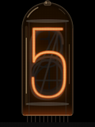

[nixie_tube.py](nixie_tube.py)

Draw a nixie tube with each digit lighting up inside the glass. The digit carrying current glows red-orange through the anode mesh.

 

### Segment Clock
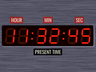

[segment_clock.py](segment_clock.py)

Draw a seven-segment LED clock behind a coloured filter. It glows red, amber or green, in a brushed metal case or bare on black.

 

### Segment Sign
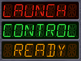

[segment_sign.py](segment_sign.py)

Draw a three-line fourteen-segment LED sign in a brushed metal case, or with its windows bare on black. A row too long for its window scrolls through it.

 

### Odometer
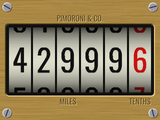

[odometer.py](odometer.py)

Draw a mechanical odometer with number drums rolling in a brass frame. The last drum turns steadily, and each of the others is carried round as the drum to its right passes from 9 to 0.

 

### Lamp Matrix
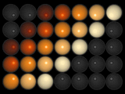

[lamp_matrix.py](lamp_matrix.py)

Draw a grid of stage lamps running through a light show. Tungsten lamps glow up quickly and fade slowly, white hot through orange to a dull red as each filament cools. LED lamps can take their place, switching instantly between a handful of colours and off.

 

### Oscilloscope
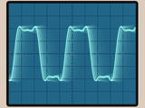

[oscilloscope.py](oscilloscope.py)

Draw an oscilloscope tracing waves that slowly fade on the screen. A scrolling sine grows into a square wave a harmonic at a time and melts back, and then the scope switches to XY mode for a turning Lissajous figure.

 

## Billboards and Panels

Posters and signs that change on screen.

### Trivision Billboard
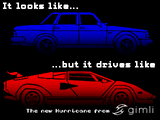

[trivision_billboard.py](trivision_billboard.py)

Draw a trivision billboard whose three-sided slats turn to change the poster.

 

### Street Billboard

[street_billboard.py](street_billboard.py)

Show a folder of posters as if each stood in a case behind glass.

 

## Animated Scenes

Drawn in code.

### Laser Show
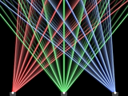

[laser_show.py](laser_show.py)

Draw a laser show of beams fanning and sweeping across a dark hall. Each scene runs a few seconds, switching its projectors on and off as it goes. An upright or square panel has room for the outer two projectors only.

 

### Fireplace
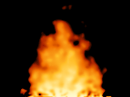

[fireplace.py](fireplace.py)

Draw a fire burning up from below the screen, whose flames break into tongues as they cool. The fire fills the panel, leaving the surround to whatever it is mounted in.

 

### Portal
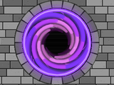

[portal.py](portal.py)

Draw a glowing portal with arms spiralling into a dark opening and specks of light falling in. Each arm dims to black before the opening, so it seems to fall away without end. It glows violet, ember, ice or emerald, with a round or oval rim, set into a stone wall or alone on black.

 

### Pool
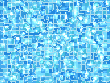

[pool.py](pool.py)

Draw the floor of a pool through rippling water that throws bright lines of light over the tiles. The floor is a modern pool's blue mosaic or a Roman bath's cream stones round an octagon.

 

### Neon Corridor
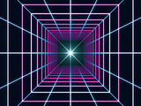

[neon_corridor.py](neon_corridor.py)

Walk without end down a corridor of neon, as rings of light come out of the haze towards you and a bright light shines at the far end. It comes in neon, plaid, emerald, magenta or blueprint colours, at a slow, normal, fast or ludicrous pace, and square or stretched to the panel's shape.

 

### Creature Eyes
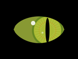

[creature_eyes.py](creature_eyes.py)

Draw a creature's eye as it looks around and blinks. The cat, owl, goat, alien, robot and zombie each have their own eyes and their own way of looking about.

 
