# Mighty FX Micropython Screen Examples <!-- omit in toc -->

These are micropython examples for the screens Mighty FX can drive from its SP/CE ports, one panel at a time, as a pair, or across a hub.

- [Single Screen Examples](#single-screen-examples)
  - [Detect Screens](#detect-screens)
  - [Backlight Fade](#backlight-fade)
  - [Screen Sizes](#screen-sizes)
- [Graphics Examples](#graphics-examples)
  - [Colour Wheel](#colour-wheel)
  - [Starfield](#starfield)
  - [Pixel Fonts](#pixel-fonts)
  - [LED Matrix](#led-matrix)
  - [Shapes](#shapes)
  - [Paths](#paths)
  - [Pens](#pens)
  - [Filters](#filters)
  - [Colours](#colours)
  - [Text Layout](#text-layout)
  - [Vector Fonts](#vector-fonts)
  - [Sprites](#sprites)
  - [Easing Curves](#easing-curves)
- [Image Examples](#image-examples)
  - [Alternating Images](#alternating-images)
  - [Poster Ticker](#poster-ticker)
- [Layout Examples](#layout-examples)
  - [Bouncing Logo](#bouncing-logo)
  - [Orientations](#orientations)
  - [Pixel Doubled](#pixel-doubled)
  - [Kaleidoscope](#kaleidoscope)
  - [Tiled Bricks](#tiled-bricks)
  - [Tiled Arrows](#tiled-arrows)
- [Screen Pair Examples](#screen-pair-examples)
  - [Colour Wheel (Paired)](#colour-wheel-paired)
  - [Colour Wheel (Unpaired)](#colour-wheel-unpaired)
  - [Colour Wheel (Facing)](#colour-wheel-facing)
  - [Drifting Carpets](#drifting-carpets)
  - [Test Cards Paired](#test-cards-paired)
- [Screen Hub Examples](#screen-hub-examples)
  - [Detect Hub](#detect-hub)
  - [Chevron Banks](#chevron-banks)
  - [Starfield (Wall)](#starfield-wall)
- [Playback Examples](#playback-examples)
  - [Animated GIF](#animated-gif)
  - [Animated GIF (Paired)](#animated-gif-paired)
  - [Animated GIF (Ping Pong)](#animated-gif-ping-pong)
  - [Body Scanner](#body-scanner)
  - [Street Billboard](#street-billboard)
  - [Billboard (Folders)](#billboard-folders)
  - [Billboard (Paired)](#billboard-paired)
  - [Billboard (Slideshow)](#billboard-slideshow)
  - [Billboard (Wall)](#billboard-wall)
  - [Animated GIF (Dual)](#animated-gif-dual)
  - [Neon Rosie](#neon-rosie)
  - [Circuit Traces](#circuit-traces)
  - [Circuit Traces (Wall)](#circuit-traces-wall)

## Single Screen Examples

### Detect Screens
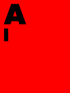
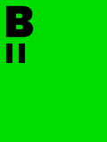

[single/detect_screens.py](single/detect_screens.py)

Show which screen sits on each SP/CE port. Every screen is painted its port's colour, with its letter in the top left over one bar for A or two for B.

 

### Backlight Fade
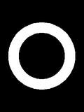

[single/backlight_fade.py](single/backlight_fade.py)

Fade a screen's backlight up and down over a still frame.

 

### Screen Sizes
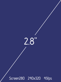
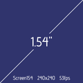

[single/screen_sizes.py](single/screen_sizes.py)

Build both screen types explicitly, one on each SP/CE port, and let each panel say which it is.

 

## Graphics Examples

### Colour Wheel
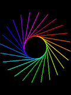

[graphics/color_wheel.py](graphics/color_wheel.py)

Spin a rainbow wheel on a screen.

 

### Starfield
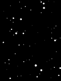

[graphics/starfield.py](graphics/starfield.py)

Travel through a star field.

 

### Pixel Fonts
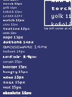

[graphics/pixel_fonts.py](graphics/pixel_fonts.py)

Scroll a line of text in each built-in pixel font from smallest to largest.

 

### LED Matrix
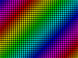

[graphics/led_matrix.py](graphics/led_matrix.py)

Show a rainbow on an LED matrix sign made of round lamps.

 

### Shapes
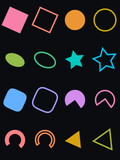

[graphics/shapes.py](graphics/shapes.py)

Spin every built-in shape both filled and outlined.

 

### Paths
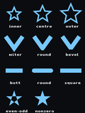

[graphics/paths.py](graphics/paths.py)

Compare the settings that change how a path is drawn.

 

### Pens
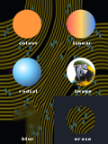

[graphics/pens.py](graphics/pens.py)

Fill a circle with six pens ranging from a plain colour to a picture.

 

### Filters
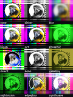

[graphics/filters.py](graphics/filters.py)

Compare eleven filters on the same picture.

 

### Colours
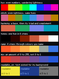

[graphics/colours.py](graphics/colours.py)

Mix evenly spaced hues and pick text colours that stay readable on any background.

 

### Text Layout
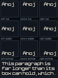

[graphics/text_layout.py](graphics/text_layout.py)

Wrap and align text inside a box.

 

### Vector Fonts
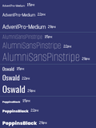

[graphics/vector_fonts.py](graphics/vector_fonts.py)

Write each built-in vector font's name in that font at several sizes.

 

### Sprites
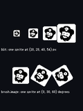

[graphics/sprites.py](graphics/sprites.py)

Draw a sprite with blit() and with an image pen that can also rotate it.

 

### Easing Curves
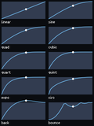

[graphics/easing_curves.py](graphics/easing_curves.py)

Plot every easing curve with a marker moving along each one.

 

## Image Examples

### Alternating Images
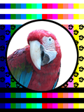

[images/alternating_images.py](images/alternating_images.py)

Switch between two PNG pictures shown for different lengths of time.

 

### Poster Ticker
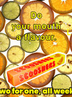

[images/poster_ticker.py](images/poster_ticker.py)

Scroll a message across a poster in lettering that matches it.

 

## Layout Examples

### Bouncing Logo
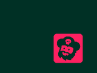

[layout/bouncing_logo.py](layout/bouncing_logo.py)

Bounce a logo around the screen and change its colour at each edge.

 

### Orientations
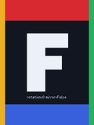

[layout/orientations.py](layout/orientations.py)

Show the eight ways a picture can be rotated and mirrored on a screen.

 

### Pixel Doubled
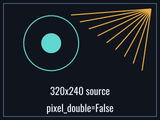

[layout/pixel_doubled.py](layout/pixel_doubled.py)

Fill the screen by doubling every pixel of a picture half its width and height.

 

### Kaleidoscope
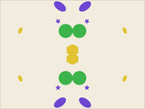

[layout/kaleidoscope.py](layout/kaleidoscope.py)

Turn a kaleidoscope of coloured beads.

 

### Tiled Bricks
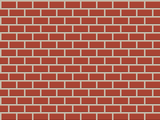

[layout/tiled_bricks.py](layout/tiled_bricks.py)

Fill the whole panel with a brick wall drawn from a tile of 32 by 32 pixels.

 

### Tiled Arrows
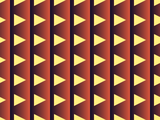

[layout/tiled_arrows.py](layout/tiled_arrows.py)

Fill the screen with a tile mirrored on every other copy to make its edges line up.

 

## Screen Pair Examples

### Colour Wheel (Paired)
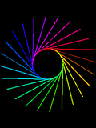

[pair/color_wheel_paired.py](pair/color_wheel_paired.py)

Spin a rainbow wheel on two screens that are redrawn together.

 

### Colour Wheel (Unpaired)

[pair/color_wheel_unpaired.py](pair/color_wheel_unpaired.py)

Spin a rainbow wheel on two screens that are redrawn one after the other. Run color_wheel_paired.py to see what a pair does differently.

 

### Colour Wheel (Facing)

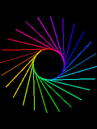

[pair/color_wheel_facing.py](pair/color_wheel_facing.py)

Spin a rainbow wheel on two facing screens with one of them mirrored.

 

### Drifting Carpets
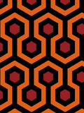
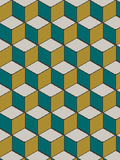

[pair/drifting_carpets.py](pair/drifting_carpets.py)

Drift a different patterned carpet across each of two screens.

 

### Test Cards Paired
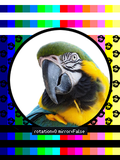
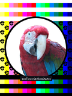

[pair/test_cards_paired.py](pair/test_cards_paired.py)

Step a test card through each rotation on two screens that mirror each other.

 

## Screen Hub Examples

### Detect Hub
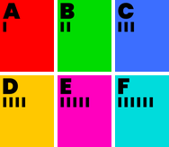

[hub/detect_hub.py](hub/detect_hub.py)

Show which screen is in each position on a Screen Hub. Every panel is painted its position's colour, with its letter in the top left over one bar for A up to six for F.

 

### Chevron Banks
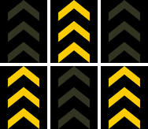

[hub/chevron_banks.py](hub/chevron_banks.py)

Flash runway chevrons on alternating sets of screens across a Screen Hub.

 

### Starfield (Wall)
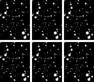

[hub/starfield_wall.py](hub/starfield_wall.py)

Travel through a star field across every screen on a Screen Hub.

 

## Playback Examples

### Animated GIF
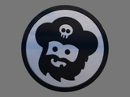

[playback/animated_gif.py](playback/animated_gif.py)

Play an animated GIF on a screen with the timing saved in the file.

 

### Animated GIF (Paired)

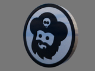

[playback/animated_gif_paired.py](playback/animated_gif_paired.py)

Play the same animated GIF in step on two screens.

 

### Animated GIF (Ping Pong)
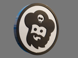

[playback/animated_gif_ping_pong.py](playback/animated_gif_ping_pong.py)

Play an animated GIF forwards then backwards with a pause at each end.

 

### Body Scanner
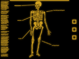

[playback/animated_gif_recoloured.py](playback/animated_gif_recoloured.py)

Change the colours of an animated GIF as it plays.

 

### Street Billboard

[playback/street_billboard.py](playback/street_billboard.py)

Show a folder of posters as if each stood in a case behind glass.

 

### Billboard (Folders)
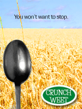

[playback/billboard_folders.py](playback/billboard_folders.py)

Show posters from several folders and skip to the next poster or folder with Boot.

 

### Billboard (Paired)
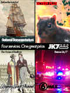
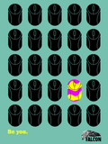

[playback/billboard_paired.py](playback/billboard_paired.py)

Show a different poster on each of two screens and change them together.

 

### Billboard (Slideshow)
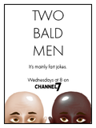

[playback/billboard_slideshow.py](playback/billboard_slideshow.py)

Show a folder of posters one at a time.

 

### Billboard (Wall)
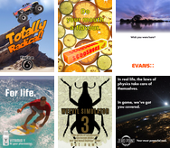

[playback/billboard_wall.py](playback/billboard_wall.py)

Show a different poster on every screen of a Screen Hub and change them all together.

 

### Animated GIF (Dual)
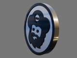
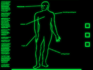

[playback/dual_animated_gifs.py](playback/dual_animated_gifs.py)

Play two animated GIFs of different sizes, lengths and speeds on two screens.

 

### Neon Rosie
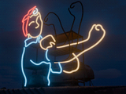

[playback/neon_ping_pong.py](playback/neon_ping_pong.py)

Play a folder of picture frames forwards then backwards.

 

### Circuit Traces
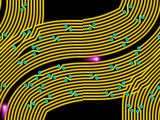

[playback/traces_scroll.py](playback/traces_scroll.py)

Scroll an animated pattern that curves between horizontal and vertical.

 

### Circuit Traces (Wall)
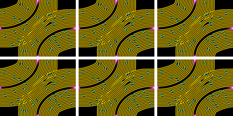

[playback/traces_wall.py](playback/traces_wall.py)

Play the same animation on every screen of a Screen Hub.

 
