# Mighty FX Micropython Showcase Examples <!-- omit in toc -->

This folder contains a collection of *Showcase* examples, that bring together concepts presented by individual board and screen examples to create functional projects.

The posters the two billboards show live with the other example art in [pictures/billboards](../pictures/billboards), portrait and landscape in a folder each: the scrolling one walks the portrait ones, the trivision one turns the three landscape.

- [Transport Signs](#transport-signs)
  - [Roadworks Sign](#roadworks-sign)
  - [Lane Control Gantry](#lane-control-gantry)
  - [Split Flap Departures](#split-flap-departures)
  - [Departure Board](#departure-board)
  - [Departures List](#departures-list)
  - [Bus Departures](#bus-departures)
  - [Tram Stop Sign](#tram-stop-sign)
- [Retro Displays](#retro-displays)
  - [Flip Dot Sign](#flip-dot-sign)
  - [Split Flap Clock](#split-flap-clock)
  - [CRT Terminal](#crt-terminal)
  - [Acrylic Lixie](#acrylic-lixie)
  - [Nixie Tube](#nixie-tube)
  - [Segment Clock](#segment-clock)
  - [Segment Sign](#segment-sign)
  - [Odometer](#odometer)
  - [Lamp Matrix](#lamp-matrix)
  - [Oscilloscope](#oscilloscope)
- [Billboards and Panels](#billboards-and-panels)
  - [Trivision Billboard](#trivision-billboard)
  - [Scrolling Billboard](#scrolling-billboard)
  - [Status Panel](#status-panel)
- [Animated Scenes](#animated-scenes)
  - [Isometric Flight](#isometric-flight)
  - [Skyline](#skyline)
  - [Laser Show](#laser-show)
  - [Fireplace](#fireplace)
  - [Portal](#portal)
  - [Pool](#pool)
  - [Creature Eyes](#creature-eyes)
- [Moving Things](#moving-things)
  - [Programmed Route](#programmed-route)

## Transport Signs

Departure boards and road signs.

### Roadworks Sign
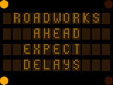

[roadworks_sign.py](roadworks_sign.py)

Draw a roadside roadworks sign with its message in amber lamps.

 

### Lane Control Gantry
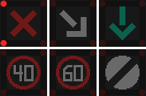

[lane_control_gantry.py](lane_control_gantry.py)

Draw the lane signals on a motorway gantry as they close a lane.

 

### Split Flap Departures
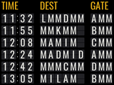

[split_flap_departures.py](split_flap_departures.py)

Draw a split-flap departures board with each letter flipping into place.

 

### Departure Board
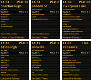

[departure_board.py](departure_board.py)

Draw a railway departure board across a Screen Hub with one train on each screen.

 

### Departures List
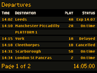
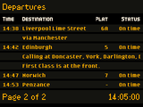

[departures_list.py](departures_list.py)

Draw a railway departures list on one screen or on two screens that change page together.

 

### Bus Departures
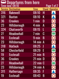
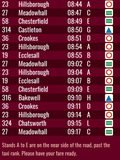

[bus_departures.py](bus_departures.py)

Draw a bus departure board as shown on a TV screen at a bus station. A second panel lengthens the board, with one listing across both.

 

### Tram Stop Sign
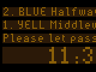
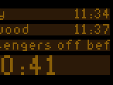

[tram_stop_sign.py](tram_stop_sign.py)

Draw a tram stop sign across two screens with the next tram at the top and later ones cycling below.

 

## Retro Displays

Mechanical, glowing and segment displays.

### Flip Dot Sign
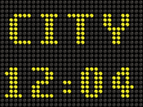

[flip_dot_sign.py](flip_dot_sign.py)

Draw a flip-dot sign that spells its message by flipping one column of dots at a time.

 

### Split Flap Clock
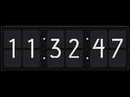

[split_flap_clock.py](split_flap_clock.py)

Draw a split-flap clock with each digit flipping through to the next.

 

### CRT Terminal
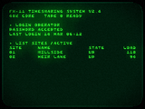

[crt_terminal.py](crt_terminal.py)

Draw an old green-screen computer terminal. An operator types a command a character at a time and the machine answers a line at a time, on a tube that glows.

 

### Acrylic Lixie
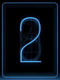

[acrylic_lixie.py](acrylic_lixie.py)

Draw a lixie display that lights one engraved acrylic sheet at a time to show each digit.

 

### Nixie Tube
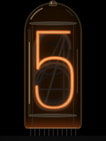

[nixie_tube.py](nixie_tube.py)

Draw a nixie tube with each digit lighting up inside the glass. The digit carrying current glows red-orange through the anode mesh.

 

### Segment Clock
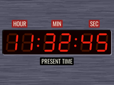

[segment_clock.py](segment_clock.py)

Draw a seven-segment LED clock behind a coloured filter.

 

### Segment Sign
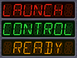

[segment_sign.py](segment_sign.py)

Draw a three-line fourteen-segment LED sign in a brushed metal case. A row too long for its window scrolls through it.

 

### Odometer
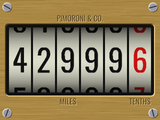

[odometer.py](odometer.py)

Draw a mechanical odometer with number drums rolling in a brass frame. The last drum turns steadily, and each of the others is carried round as the drum to its right passes from 9 to 0.

 

### Lamp Matrix
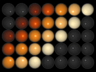

[lamp_matrix.py](lamp_matrix.py)

Draw a grid of stage lamps running through a light show. Tungsten lamps glow up quickly and fade slowly, white hot through orange to a dull red as each filament cools. LAMPS = "led" switches each instantly to one of a handful of colours, or off, instead.

 

### Oscilloscope
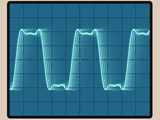

[oscilloscope.py](oscilloscope.py)

Draw an oscilloscope tracing waves that slowly fade on the screen. A scrolling sine grows into a square wave a harmonic at a time and melts back, then the scope switches to XY mode for a turning Lissajous figure. SENSOR = True traces the voltage on the sensor connector instead.

 

## Billboards and Panels

Posters and signs that change on screen.

### Trivision Billboard
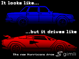

[trivision_billboard.py](trivision_billboard.py)

Draw a trivision billboard whose three-sided slats turn to change the poster.

 

### Scrolling Billboard
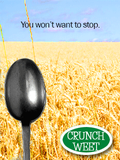

[scrolling_billboard.py](scrolling_billboard.py)

Draw a scrolling billboard that rolls its posters past one at a time.

 

### Status Panel
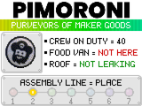

[status_panel.py](status_panel.py)

Draw a Pimoroni status panel with the RGB outputs lighting in step with its production line.

 

## Animated Scenes

Drawn in code.

### Isometric Flight
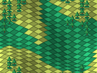
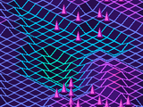

[isometric_flight.py](isometric_flight.py)

Fly endlessly over two isometric worlds.

 

### Skyline
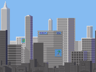

[skyline.py](skyline.py)

Drift past a city while the sky turns from noon to midnight and the windows come on.

 

### Laser Show
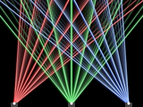

[laser_show.py](laser_show.py)

Draw a laser show of beams fanning and sweeping across a dark hall. Each scene switches its projectors on and off as it goes. An upright or square panel has room for the outer two projectors only.

 

### Fireplace
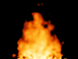

[fireplace.py](fireplace.py)

Draw a fire and flicker the RGB outputs with it like firelight in a room. The fire fills the panel, leaving the surround to whatever it is mounted in.

 

### Portal
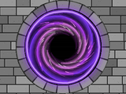

[portal.py](portal.py)

Draw a glowing portal with arms spiralling into a dark opening and specks of light falling in. Each arm dims to black before the opening, so it seems to fall away without end. STONES = True sets it into a stone wall, and RIM_WIDTH and RIM_HEIGHT size it to a cutout in front of the panel.

 

### Pool
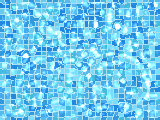

[pool.py](pool.py)

Draw the floor of a pool through rippling water that throws bright lines of light over the tiles. STYLE chooses the floor to start on, a modern pool's blue mosaic or a Roman bath's cream stones round an octagon, and "Boot" swaps to the other.

 

### Creature Eyes

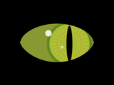

[creature_eyes.py](creature_eyes.py)

Draw a creature's eyes on two screens as they look around and blink. CREATURE chooses the cat, owl, goat, alien, robot or zombie, each with its own eyes and its own way of looking about, and "Boot" steps to the next.

 

## Moving Things

Servos and motors.

### Programmed Route
[programmed_route.py](programmed_route.py)

Program a route into a two-wheeled robot with the IR remote and watch it drive.
