# Mighty FX Micropython Screen Examples <!-- omit in toc -->

These are micropython examples for the screens Mighty FX can drive from its SP/CE ports, one panel at a time, as a pair, or across a hub.

- [Single Screen Examples](#single-screen-examples)
  - [Detect Screens](#detect-screens)
  - [Backlight Fade](#backlight-fade)
  - [Screen Sizes](#screen-sizes)
- [Graphics Examples](#graphics-examples)
  - [Colour Wheel](#colour-wheel)
  - [Starfield](#starfield)
  - [Pixel Fonts](#pixel-fonts)
  - [LED Matrix](#led-matrix)
  - [Shapes](#shapes)
  - [Paths](#paths)
  - [Pens](#pens)
  - [Filters](#filters)
  - [Colours](#colours)
  - [Text Layout](#text-layout)
  - [Vector Fonts](#vector-fonts)
  - [Sprites](#sprites)
  - [Tweens](#tweens)
- [Image Examples](#image-examples)
  - [Alternating Images](#alternating-images)
  - [Poster Ticker](#poster-ticker)
- [Layout Examples](#layout-examples)
  - [Bouncing Logo](#bouncing-logo)
  - [Orientations](#orientations)
  - [Pixel Doubled](#pixel-doubled)
  - [Kaleidoscope](#kaleidoscope)
  - [Tiled Bricks](#tiled-bricks)
  - [Tiled Arrows](#tiled-arrows)
- [Screen Pair Examples](#screen-pair-examples)
  - [Colour Wheel Paired](#colour-wheel-paired)
  - [Colour Wheel In Turn](#colour-wheel-in-turn)
  - [Colour Wheel Facing](#colour-wheel-facing)
  - [Carpets Paired](#carpets-paired)
  - [Test Cards Paired](#test-cards-paired)
- [Screen Hub Examples](#screen-hub-examples)
  - [Detect Hub](#detect-hub)
  - [Chevron Banks](#chevron-banks)
  - [Starfield Wall](#starfield-wall)
- [Playback Examples](#playback-examples)
  - [Animated GIF](#animated-gif)
  - [Animated GIF Paired](#animated-gif-paired)
  - [Animated GIF Ping Pong](#animated-gif-ping-pong)
  - [Animated GIF Recoloured](#animated-gif-recoloured)
  - [Billboard Cased](#billboard-cased)
  - [Billboard Folders](#billboard-folders)
  - [Billboard Paired](#billboard-paired)
  - [Billboard Slideshow](#billboard-slideshow)
  - [Billboard Wall](#billboard-wall)
  - [Dual Animated GIFs](#dual-animated-gifs)
  - [Neon Ping Pong](#neon-ping-pong)
  - [Traces Scroll](#traces-scroll)
  - [Traces Wall](#traces-wall)

## Single Screen Examples

### Detect Screens
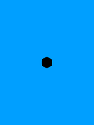
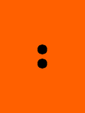

[single/detect_screens.py](single/detect_screens.py)

Draw to whichever screens are plugged in, on one SP/CE port or both. Each screen counts out its own position in dots.

 

### Backlight Fade
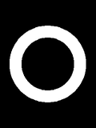

[single/backlight_fade.py](single/backlight_fade.py)

Fade a screen's backlight up and down over a still frame.

 

### Screen Sizes
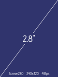
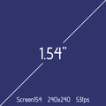

[single/screen_sizes.py](single/screen_sizes.py)

Build both screen types explicitly, one on each SP/CE port, and let each panel say which it is.

 

## Graphics Examples

### Colour Wheel
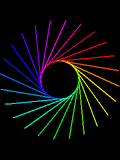

[graphics/color_wheel.py](graphics/color_wheel.py)

Spin a rainbow wheel on a screen.

 

### Starfield
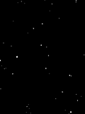

[graphics/starfield.py](graphics/starfield.py)

Travel through a star field.

 

### Pixel Fonts
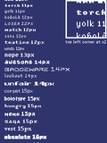

[graphics/pixel_fonts.py](graphics/pixel_fonts.py)

Scroll a line in every ROM pixel font, smallest first, with each one's height beside its name.

 

### LED Matrix
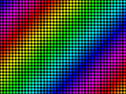

[graphics/led_matrix.py](graphics/led_matrix.py)

Show a rainbow as an LED matrix sign, each pixel drawn as a round lamp behind a dark face.

 

### Shapes
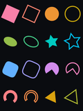

[graphics/shapes.py](graphics/shapes.py)

Draw every shape picovector offers, each one filled and then stroked beside it, all turning.

 

### Paths
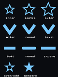

[graphics/paths.py](graphics/paths.py)

Show every setting that decides how a path is drawn, side by side.

 

### Pens
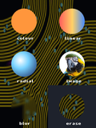

[graphics/pens.py](graphics/pens.py)

Fill the same circle with six different pens, from a plain colour to a picture.

 

### Filters
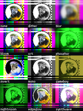

[graphics/filters.py](graphics/filters.py)

Show one picture under eleven filters side by side, to compare what each one does.

 

### Colours
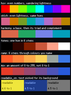

[graphics/colours.py](graphics/colours.py)

Build colours from the colour module, from even hues to readable text on any background.

 

### Text Layout
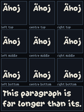

[graphics/text_layout.py](graphics/text_layout.py)

Lay text out inside a box, which wraps and aligns it.

 

### Vector Fonts
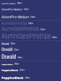

[graphics/vector_fonts.py](graphics/vector_fonts.py)

Draw every vector face in ROM at three sizes, each writing its own name.

 

### Sprites
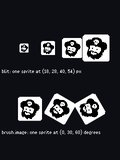

[graphics/sprites.py](graphics/sprites.py)

Draw the same sprite with blit() and with an image pen, which can also turn it.

 

### Tweens
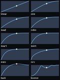

[graphics/tweens.py](graphics/tweens.py)

Plot what each easing curve does, with a marker running along every one of them at once.

 

## Image Examples

### Alternating Images
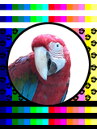

[images/alternating_images.py](images/alternating_images.py)

Alternate between two PNG pictures, each shown for its own time.

 

### Poster Ticker
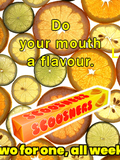

[images/poster_ticker.py](images/poster_ticker.py)

Scroll a message across a poster read from a file, in lettering matching the poster's own.

 

## Layout Examples

### Bouncing Logo
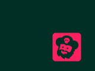

[layout/bouncing_logo.py](layout/bouncing_logo.py)

Bounce a logo around the screen, recolouring it at each edge while the drifting background shows through its darkest parts.

 

### Orientations
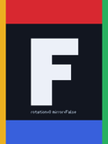

[layout/orientations.py](layout/orientations.py)

Show one mark in all eight ways a panel can carry it.

 

### Pixel Doubled
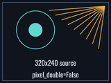

[layout/pixel_doubled.py](layout/pixel_doubled.py)

Fill the panel from a source a quarter of its size, doubling every pixel.

 

### Kaleidoscope
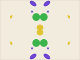

[layout/kaleidoscope.py](layout/kaleidoscope.py)

Turn a kaleidoscope, from a set of small frames drawn once at startup.

 

### Tiled Bricks
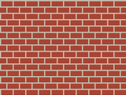

[layout/tiled_bricks.py](layout/tiled_bricks.py)

Fill the whole panel with a brick wall drawn from a tile of 32 by 32 pixels.

 

### Tiled Arrows
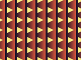

[layout/tiled_arrows.py](layout/tiled_arrows.py)

Fill the panel from a tile whose edges do not meet, using a mirrored repeat so they do.

 

## Screen Pair Examples

### Colour Wheel Paired

[pair/color_wheel_paired.py](pair/color_wheel_paired.py)

Spin a rainbow wheel on a pair of screens held in step.

 

### Colour Wheel In Turn
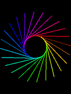

[pair/color_wheel_in_turn.py](pair/color_wheel_in_turn.py)

Spin a rainbow wheel on two screens, updated one after the other. Run color_wheel_paired.py to see what a pair does differently.

 

### Colour Wheel Facing

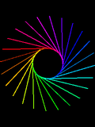

[pair/color_wheel_facing.py](pair/color_wheel_facing.py)

Spin a rainbow wheel on a pair of screens facing each other, one of them mirrored to suit.

 

### Carpets Paired
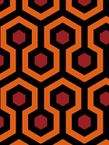
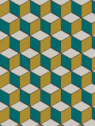

[pair/carpets_paired.py](pair/carpets_paired.py)

Lay a different drifting carpet on each panel of a pair, each tiled from a small scrap of pattern.

 

### Test Cards Paired
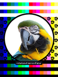
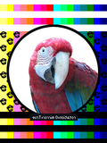

[pair/test_cards_paired.py](pair/test_cards_paired.py)

Turn a test card on each panel of a pair, the second one mirrored against the first.

 

## Screen Hub Examples

### Detect Hub
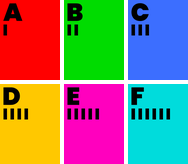

[hub/detect_hub.py](hub/detect_hub.py)

Show which panel sits at each position of a screen hub. Every panel is painted its position's colour, with its letter in the top left over one bar for A up to six for F.

 

### Chevron Banks
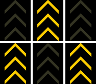

[hub/chevron_banks.py](hub/chevron_banks.py)

Flash runway chevrons across a screen hub in two interleaved banks, each a subset of one group.

 

### Starfield Wall
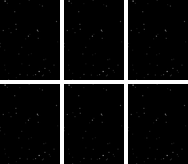

[hub/starfield_wall.py](hub/starfield_wall.py)

Travel through a star field, across every panel a screen hub reaches.

 

## Playback Examples

### Animated GIF
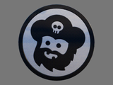

[playback/animated_gif.py](playback/animated_gif.py)

Play an animated GIF on a screen, at the frame delays the file was authored with.

 

### Animated GIF Paired

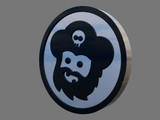

[playback/animated_gif_paired.py](playback/animated_gif_paired.py)

Play one animated GIF across two screens, both changing frame together.

 

### Animated GIF Ping Pong
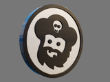

[playback/animated_gif_ping_pong.py](playback/animated_gif_ping_pong.py)

Play an animated GIF forward then back, dwelling at each turn.

 

### Animated GIF Recoloured
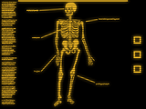

[playback/animated_gif_recoloured.py](playback/animated_gif_recoloured.py)

Recolour a whole animation as it plays, by rewriting the one colour table its frames share.

 

### Billboard Cased

[playback/billboard_cased.py](playback/billboard_cased.py)

Show a folder of posters as if each stood in a case behind glass.

 

### Billboard Folders
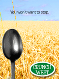

[playback/billboard_folders.py](playback/billboard_folders.py)

Show several folders of posters, with Boot moving to the next poster or the next folder.

 

### Billboard Paired
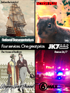
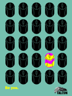

[playback/billboard_paired.py](playback/billboard_paired.py)

Show two different posters at once, one on each of a pair of screens, both changing together.

 

### Billboard Slideshow

[playback/billboard_slideshow.py](playback/billboard_slideshow.py)

Show a folder of posters, one at a time, sent straight to the panel.

 

### Billboard Wall
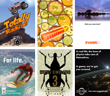

[playback/billboard_wall.py](playback/billboard_wall.py)

Show a different poster on every panel a hub can reach, all changing on one clock.

 

### Dual Animated GIFs
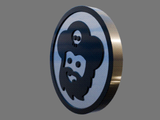
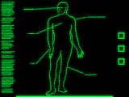

[playback/dual_animated_gifs.py](playback/dual_animated_gifs.py)

Play a different animated GIF on each of two screens, each its own size, length and rate.

 

### Neon Ping Pong
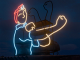

[playback/neon_ping_pong.py](playback/neon_ping_pong.py)

Play an animation held as one image file per frame, back and forth.

 

### Traces Scroll
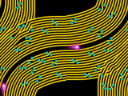

[playback/traces_scroll.py](playback/traces_scroll.py)

Scroll an animation built from one tile endlessly across the panel, turning between axes.

 

### Traces Wall
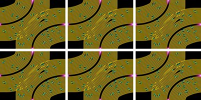

[playback/traces_wall.py](playback/traces_wall.py)

Play one animation across every panel a hub can reach, each showing the same frame.

 
