# Mighty FX Micropython Showcase Examples <!-- omit in toc -->

This folder contains a collection of *Showcase* examples, that bring together concepts presented by individual board and screen examples to create functional projects.

The posters the two billboards show live with the other example art in [assets/billboards](../assets/billboards), portrait and landscape in a folder each: the scrolling one walks the portrait ones, the trivision one turns the three landscape.

- [Transport Signs](#transport-signs)
  - [Roadworks Sign](#roadworks-sign)
  - [Lane Control Gantry](#lane-control-gantry)
  - [Split Flap Departures](#split-flap-departures)
  - [Departure Board](#departure-board)
  - [Departures List](#departures-list)
  - [Bus Departures](#bus-departures)
  - [Tram Stop Sign](#tram-stop-sign)
- [Mechanical and Glowing Displays](#mechanical-and-glowing-displays)
  - [Flip Dot Sign](#flip-dot-sign)
  - [Split Flap Clock](#split-flap-clock)
  - [CRT Terminal](#crt-terminal)
  - [Acrylic Lixie](#acrylic-lixie)
  - [Nixie Tube](#nixie-tube)
  - [Segment Clock](#segment-clock)
  - [Segment Sign](#segment-sign)
  - [Odometer](#odometer)
  - [Lamp Matrix](#lamp-matrix)
  - [Oscilloscope](#oscilloscope)
- [Billboards and Panels](#billboards-and-panels)
  - [Trivision Billboard](#trivision-billboard)
  - [Scrolling Billboard](#scrolling-billboard)
  - [Status Panel](#status-panel)
- [Animation](#animation)
  - [Isometric Flight](#isometric-flight)
  - [Skyline](#skyline)
  - [Laser Show](#laser-show)
  - [Fireplace](#fireplace)
  - [Portal](#portal)
  - [Pool](#pool)
- [Moving Things](#moving-things)
  - [Programmed Route](#programmed-route)

## Transport Signs

Departure boards and signs by the road and the track.

### Roadworks Sign
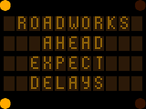

[roadworks_sign.py](roadworks_sign.py)

Draw a roadworks sign, the kind towed to the side of a road, its amber lamps behind a dark face holding a message, not scrolling it.

 

### Lane Control Gantry
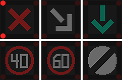

[lane_control_gantry.py](lane_control_gantry.py)

Draw a motorway lane control gantry, a signal to a lane, working through a lane closure.

 

### Split Flap Departures
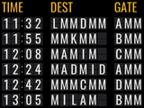

[split_flap_departures.py](split_flap_departures.py)

Draw a split-flap departures board, each card climbing through the drum to its letter.

 

### Departure Board
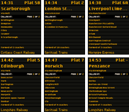

[departure_board.py](departure_board.py)

Draw a railway departure board across a screen hub, a service to each panel, every one paging its calling points on its own clock.

 

### Departures List
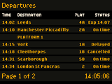
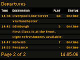

[departures_list.py](departures_list.py)

Draw a railway departures list on one screen, or across a pair turning their page together.

 

### Bus Departures
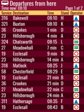
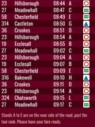

[bus_departures.py](bus_departures.py)

Draw a bus departure board on a television used for signage, antialiased vector type on a panel that is plainly a panel. A second panel lengthens the board, with one listing across both.

 

### Tram Stop Sign
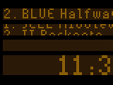
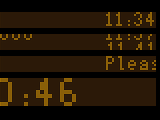

[tram_stop_sign.py](tram_stop_sign.py)

Draw a tram stop sign across two screens, amber lamps behind a dark face in a contiguous band per line, with the next tram pinned and the ones after it cycling underneath.

 

## Mechanical and Glowing Displays

Flaps, dots and tubes, as the real ones look.

### Flip Dot Sign
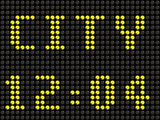

[flip_dot_sign.py](flip_dot_sign.py)

Draw a flip-dot sign, spelling its message in dots that turn over one column after the next.

 

### Split Flap Clock
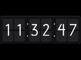

[split_flap_clock.py](split_flap_clock.py)

Draw a split-flap clock, its digits climbing through the drum a flap at a time like a real board.

 

### CRT Terminal
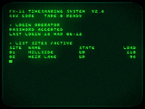

[crt_terminal.py](crt_terminal.py)

Draw a green screen terminal of the kind wheeled up to a minicomputer. An operator types a command a character at a time and the machine answers a line at a time, on a tube that glows.

 

### Acrylic Lixie
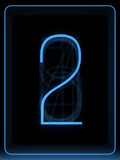

[acrylic_lixie.py](acrylic_lixie.py)

Draw a lixie, ten engraved acrylic sheets stacked front to back with a digit on each, an LED under every sheet, and only the one being shown lit.

 

### Nixie Tube
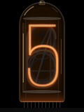

[nixie_tube.py](nixie_tube.py)

Draw a nixie tube, ten cathodes bent into digits and stacked front to back in a glass cylinder. The one carrying current glows red-orange through the anode mesh.

 

### Segment Clock
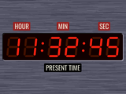

[segment_clock.py](segment_clock.py)

Draw an LED seven-segment clock, its digits made of bars lit behind a coloured filter.

 

### Segment Sign
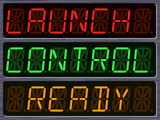

[segment_sign.py](segment_sign.py)

Draw an LED sign of fourteen-segment characters, three rows of them in windows set into a brushed metal case. A row too long for its window scrolls through it.

 

### Odometer
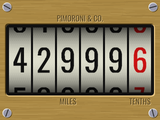

[odometer.py](odometer.py)

Draw a mechanical odometer, a row of number drums in a brass frame. The last drum turns steadily, and each of the others is carried round as the drum to its right passes from 9 to 0.

 

### Lamp Matrix
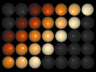

[lamp_matrix.py](lamp_matrix.py)

Draw a stage lighting lamp matrix, a panel of lamps in deep reflector cups running through cues. Tungsten lamps glow up quickly and fade slowly, white hot through orange to a dull red as each filament cools. LAMPS = "led" switches each instantly to one of a handful of colours, or off, instead.

 

### Oscilloscope
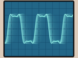

[oscilloscope.py](oscilloscope.py)

Draw an oscilloscope, a beam tracing across its graticule and leaving a fading afterglow on the phosphor. A scrolling sine grows into a square wave a harmonic at a time and melts back, then the scope switches to XY mode for a turning Lissajous figure. SENSOR = True traces the voltage on the sensor connector instead.

 

## Billboards and Panels

Posters and panels that change as you watch.

### Trivision Billboard
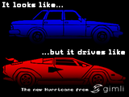

[trivision_billboard.py](trivision_billboard.py)

Draw a trivision billboard, its posters carried on three-sided slats that turn a third at a time.

 

### Scrolling Billboard
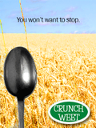

[scrolling_billboard.py](scrolling_billboard.py)

Draw a scrolling billboard, its posters carried on a loop and read from the board one at a time.

 

### Status Panel
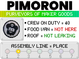

[status_panel.py](status_panel.py)

Draw a status panel for the company that made the board, a wordmark over a cycling ribbon, a coin badge, a few statuses, and the seven RGB outputs as its production line.

 

## Animation

Pictures in motion, drawn as they play.

### Isometric Flight
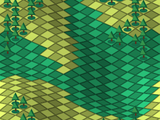
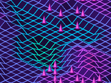

[isometric_flight.py](isometric_flight.py)

Fly for ever over two isometric worlds, each drawn once into a tile the driver repeats.

 

### Skyline
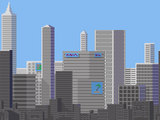

[skyline.py](skyline.py)

Drift past a city while the sky turns from noon to midnight and the windows come on.

 

### Laser Show
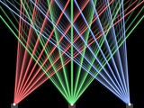

[laser_show.py](laser_show.py)

Draw a laser show, beams fanning and sweeping across a dark hall from three projectors along the foot of the stage, leaving a fading sheet behind them as beams through haze do. Each scene switches its projectors on and off as it goes. PORTRAIT = True stands the panel upright, with room for the outer two projectors only.

 

### Fireplace
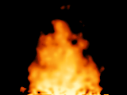

[fireplace.py](fireplace.py)

Draw a fire, its flames rising in tongues from hot spots flaring along its bed and burning out unevenly as they climb. Mighty FX's RGB outputs flicker orange with the hot spots in their share of the bed, brightest in the middle, so whatever they light glows as a room does round a fire. The fire fills the panel, leaving the surround to whatever it is mounted in.

 

### Portal
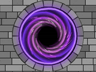

[portal.py](portal.py)

Draw a portal, glowing arms winding in towards a dark opening inside a shimmering rim, with motes of light falling in faster across them. Each arm dims to black before the opening, so it seems to fall away without end. STONES = True sets it into a stone wall, and RIM_WIDTH and RIM_HEIGHT size it to a cutout in front of the panel.

 

### Pool
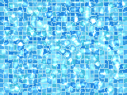

[pool.py](pool.py)

Draw the floor of a small pool seen from above through rippling water, the tiles wobbling as the surface bends the light, and bright lines of light where the surface gathers it. STYLE chooses a modern pool's blue mosaic or a Roman bath's cream stones round an octagon.

 

## Moving Things

Servos and motors.

### Programmed Route
[programmed_route.py](programmed_route.py)

Programme a two wheeled robot's route with the Aye Arr Remote, then watch it drive what it was told.
